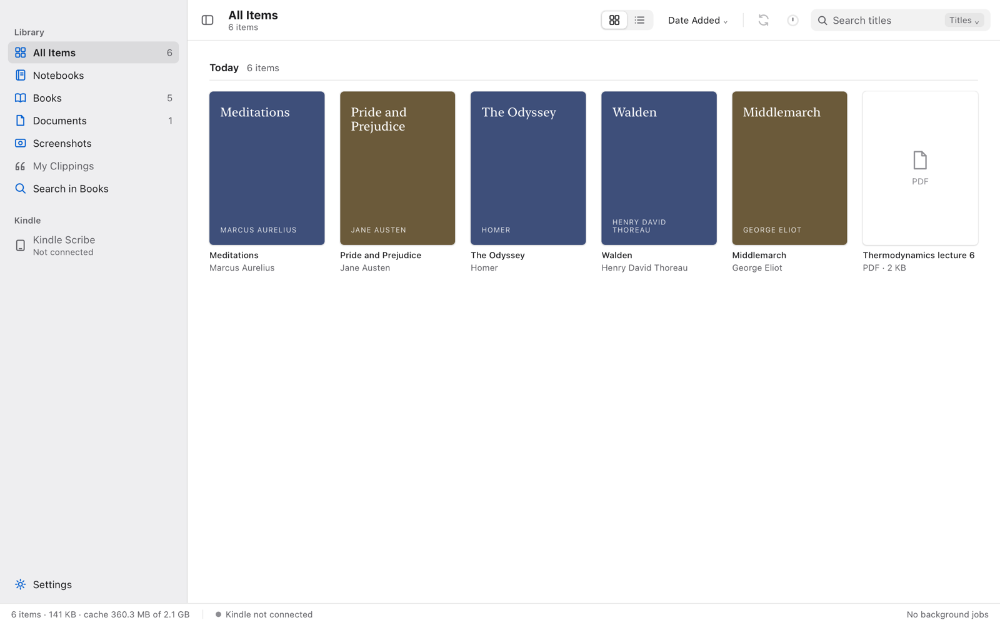
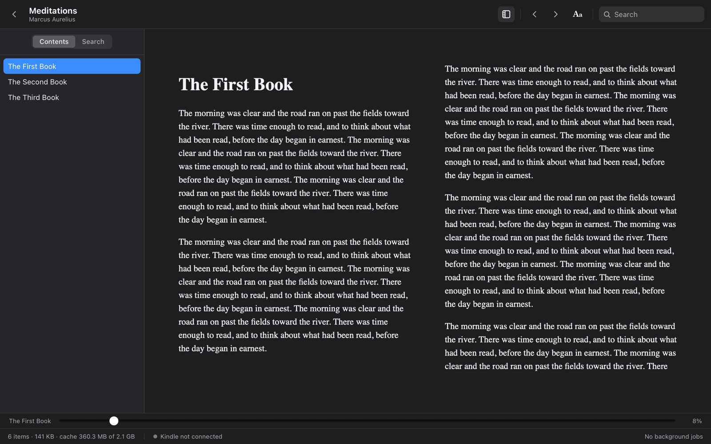
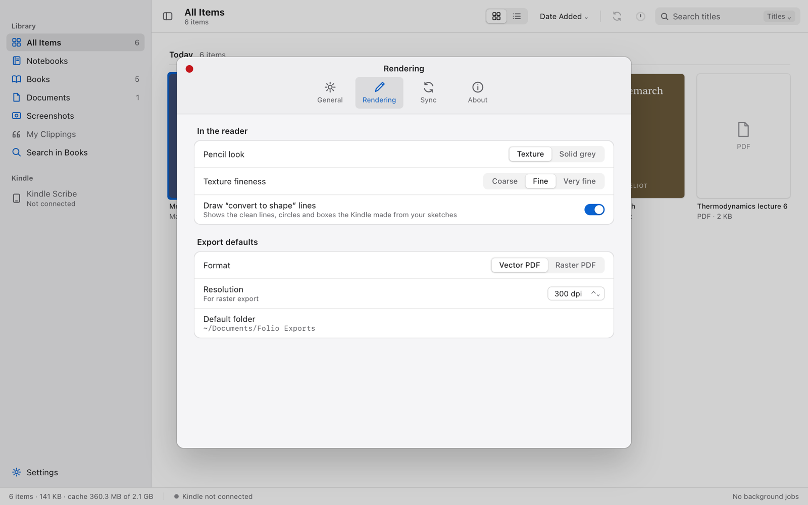
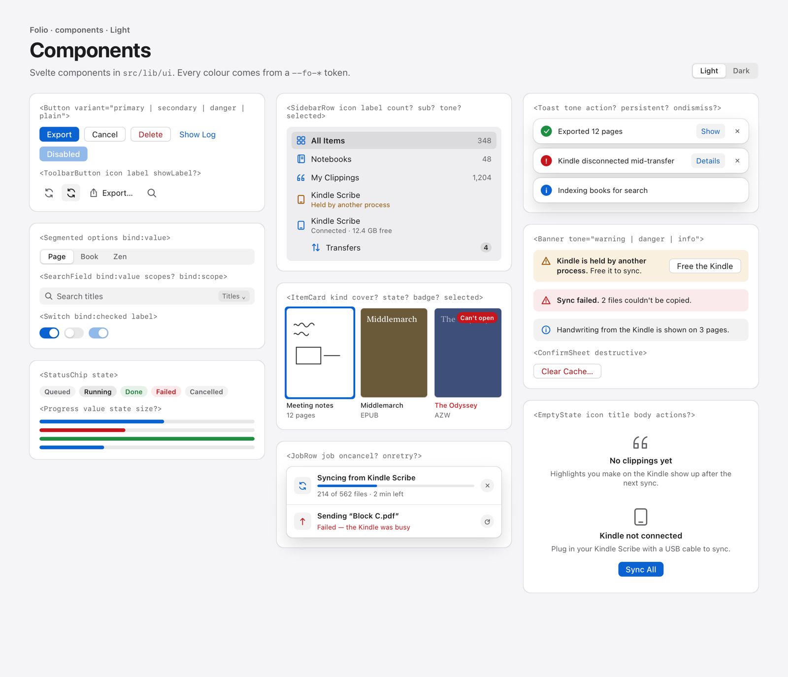
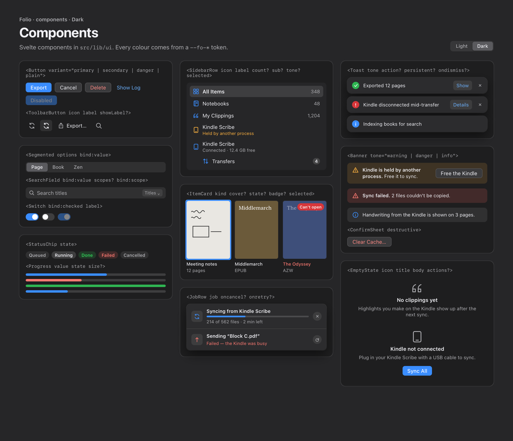

<div align="center">

# Folio

**Your Kindle Scribe's notebooks, books and PDFs on your Mac, offline.**

Folio syncs a Kindle Scribe over USB, renders its handwritten notebooks, reads its books and documents, shows the handwriting you added to PDFs, and exports everything to PDF. It's a native macOS app with no account, no cloud and no Python.

[](LICENSE)




</div>

## Features

**Sync**
- One click copies new and changed notebooks, books, PDFs and screenshots from the Kindle over USB (MTP). Unchanged files are skipped, so later syncs take seconds.
- It never changes anything on the Kindle. Downloads are atomic, and it can sync automatically when the Kindle is plugged in.
- **Free the Kindle**: when macOS's photo service grabs the USB connection, Folio can free it, and stop it from happening again.

**Handwritten notebooks**
- Decoded natively from the Kindle's KDF/Ion format: pencil texture, pens, highlighters, templates, and "convert to shape" lines, circles and boxes.
- Page, two-page Book (with a page-turn animation) and Zen modes, a pages panel, zoom, and your place remembered.
- Export to PDF: vector (sharp, small) or raster (pencil texture), all pages or a range. A 1,500-page notebook exports in about a second.

**Books and documents**
- **EPUB, MOBI, AZW3** reader: contents, search, text size, Auto/Paper/Sepia/Night themes, spacing, pages or scrolling.
- **PDF** reader: contents, find, selectable text, and **the handwriting you wrote on the PDF on the Kindle**, overlaid in place. **Export with handwriting** saves a copy with your ink as vector paths.
- **Search in Books**: full-text search across your library (SQLite FTS5).
- **My Clippings**: every highlight, note and bookmark, grouped by book.
- DRM-protected and KFX books show a clear reason instead of failing.

**The Kindle**
- Storage at a glance, a file browser (copy, delete, new folder), **Send to Kindle** by drag and drop, and a transfer queue with retry.

<p align="center">
  
  
</p>

## Install

1. Download `Folio_<version>_universal.dmg` from [Releases](https://github.com/azarezade/folio/releases), or build it yourself (below).
2. Open it and drag **Folio** to **Applications**.
3. Folio isn't notarised, so the first time:
   - **macOS 15+:** open it, then go to **System Settings → Privacy & Security** and click **Open Anyway**.
   - **macOS 12–14:** right-click Folio, choose **Open**, then **Open**.
4. Plug in your Kindle Scribe, unlock it, and click **Sync**.

[docs/install.md](docs/install.md) covers bringing a library from another Mac, where files are kept, and uninstalling.

## Build from source

You need Rust (the toolchain in `rust-toolchain.toml`), Node 20+, Python 3 and the Xcode command-line tools.

```bash
git clone https://github.com/azarezade/folio.git
cd folio
app/build.sh --universal     # → target/universal-apple-darwin/release/bundle/{macos/Folio.app,dmg/…}
```

The command-line tool is built with the workspace:

```bash
cargo build --release
target/release/folio-cli --help                  # inspect, convert, render-page, sync, push, device, serve
target/release/folio-cli convert notebook.nbk notebook.pdf --vector
```

See [docs/development.md](docs/development.md) for the dev bridge (the UI in a browser with hot reload), tests and fuzzing.

## How it works

```
Folio.app  ─  Svelte 5 UI  ⇄  one JSON API  ⇄  Rust core
                                               ├─ folio-library  sync engine, index (SQLite + FTS5), render cache
                                               ├─ folio-device   Kindle over USB MTP, hot-plug
                                               ├─ folio-nmdl     notebook model ← folio-kdf ← folio-ion
                                               ├─ folio-render   strokes → raster or vector
                                               ├─ folio-pdfout   streaming PDF writer
                                               └─ folio-kfx      book formats, DRM, covers, text
```

- **A sync only copies.** Files land in `~/Library/Application Support/Folio` (notebooks, books with their Kindle subfolders, screenshots) and are indexed.
- **Pages render when you view them** and are cached in `~/Library/Caches/Folio`.
- **PDFs are made only when you export.**

Details: [architecture](docs/architecture.md) and the [file-format notes](docs/format.md).

<details>
<summary>Design system: <code>--fo-*</code> tokens and components, light and dark</summary>
<br>


</details>

## Status and limits

- **macOS only.** Tested with a Kindle Scribe (USB product 0x9981). Other Kindles may work for books, but not tested.
- **No DRM removal.** Purchased books protected by Amazon DRM, and KFX books, can't be opened; Folio says so and leaves them alone.
- **No notebook titles or folders.** The names you give notebooks on the Kindle aren't readable over USB, so Folio lets you rename them locally.
- **Handwriting written out of page order on a PDF may be placed wrongly.** This mapping is still being verified.

## Credits

- Notebook and book decoding is a Rust port of **[kfxlib](https://www.mobileread.com/forums/showthread.php?t=291290)** by **John Howell** (GPLv3). Thank you.
- Folio follows the earlier Python app [scribe-library](https://github.com/technolaaji/scribe-library), and can import its libraries.
- [foliate-js](https://github.com/johnfactotum/foliate-js) (MIT) reads EPUB/MOBI; [PDF.js](https://mozilla.github.io/pdf.js/) (Apache-2.0) draws PDFs; [mtp-rs](https://crates.io/crates/mtp-rs) talks to the Kindle; [Tauri](https://tauri.app) is the app shell. **Help › Licences** in the app lists every component.

## License

Folio is free software under the [GNU General Public License v3.0 or later](LICENSE). It comes with no warranty.

Folio isn't affiliated with Amazon. Kindle and Kindle Scribe are trademarks of Amazon.com, Inc.
